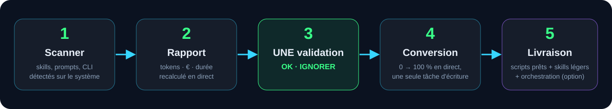
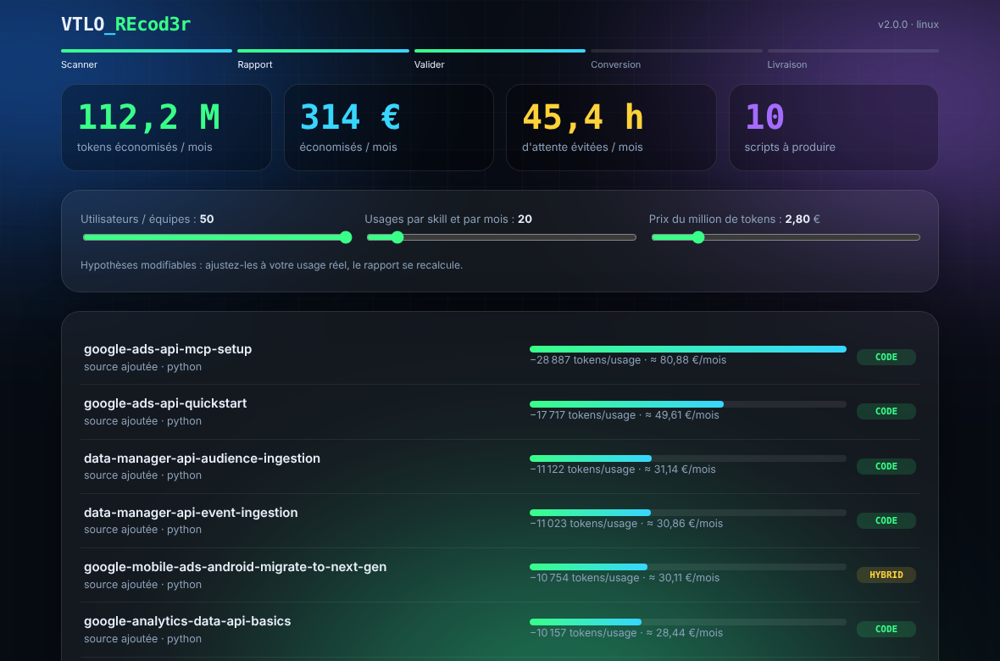
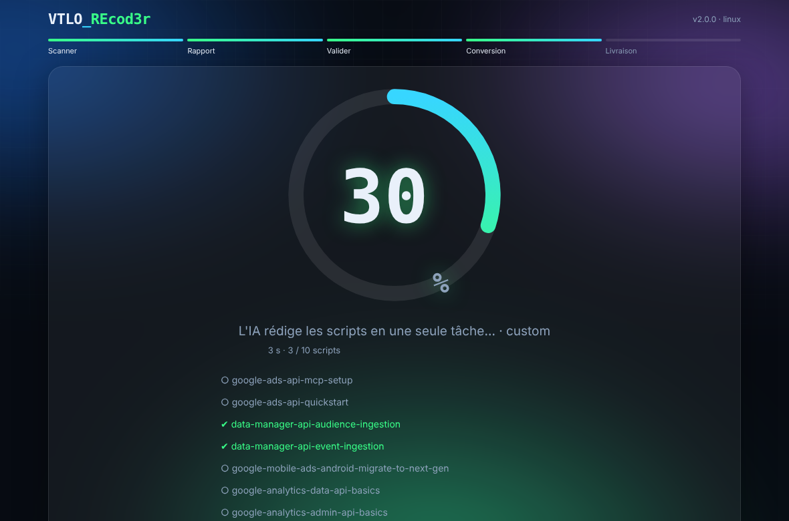
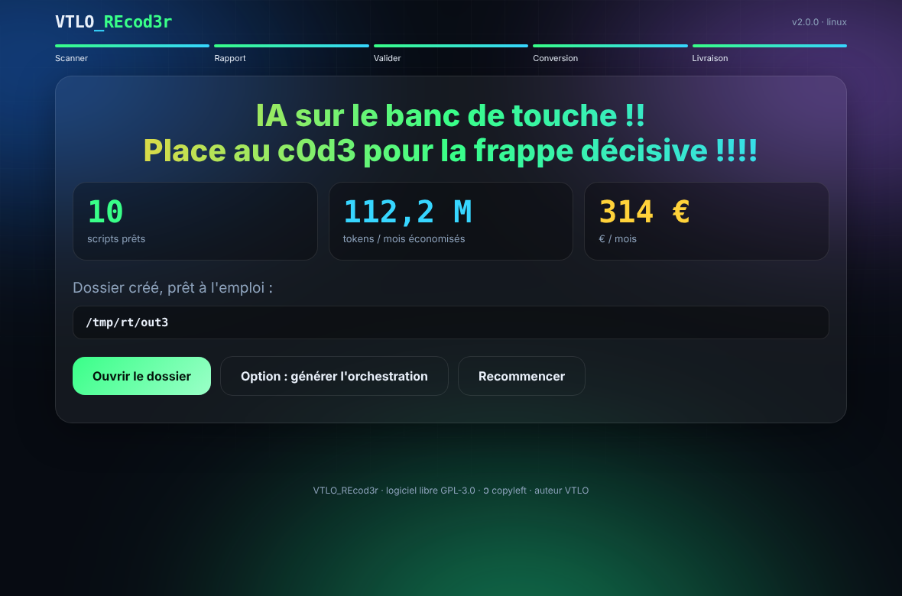

<p align="center"></p>

<p align="center">


</p>

# ∇TLO · VTLO_REcod3r

> **Faites faire au code ce qui n'a pas besoin d'IA. Gardez l'IA pour ce qui demande vraiment de réfléchir.**

VTLO_REcod3r est **la prochaine avancée de votre façon de coder et de raisonner avec « code + IA »** : plus performante, plus rapide, moins chère. C'est la méthode qui rend vos collègues numériques automatisés **prêts pour le réel** : le code exécute, l'IA décide, et le code revalide sa réponse. Pour tous ceux qui veulent des assistants de premier ordre, sans payer l'IA pour recopier la même liste tous les jours.

<p align="center"></p>

---

## ⚡ Installation en une commande

**Linux · macOS · Android (Termux)** — à coller dans un terminal, ou directement dans agy, Claude Code, Gemini CLI, Codex :

```sh
curl -fsSL https://raw.githubusercontent.com/VTLO/VTLO_REcod3r/main/install-app.sh | sh
```

**Windows (PowerShell)** :

```powershell
irm https://raw.githubusercontent.com/VTLO/VTLO_REcod3r/main/install-app.ps1 | iex
```

**Déjà installé ? Mise à jour :** `recod3r update` (ou relancez la commande ci-dessus).

Ensuite : tapez `recod3r` (application) ou `/recod3r` dans votre CLI d'IA — compatible **agy (Antigravity CLI)**, Claude Code, Gemini CLI et Codex. Python 3.8+ et git suffisent. Détails dans [Installer en une commande](#installer-en-une-commande).

---

## 1 · L'application

Une application **autonome et multiplateforme** : elle analyse votre système, vous montre ce que vous gagnez, puis convertit tout en **une seule validation**.

<p align="center"></p>

**Ce qu'elle fait**

1. **Scanne** votre machine avec les outils habituels : skills, commandes et prompts de Claude, Gemini CLI, Codex, agy… plus les dossiers ou archives `.zip` que vous ajoutez.
2. **Chiffre l'économie** pour chaque élément : **tokens, euros, durée**, nombre de scripts, amortissement. Les hypothèses (utilisateurs, usages par mois, prix du million de tokens) se règlent par curseurs et le rapport se recalcule en direct.
3. **Ne scanne rien au lancement** : sur l'écran titre, vous choisissez le **scan global** de votre système ou vos **champs manuels** (fichier, dossier avec ses annexes, `.zip`, chemin, collage). Cochez ensuite les skills à convertir. En terminal : `--add CHEMIN` (manuel, sans scan du système), `--global`, `--only skill1,skill2`, `--all`.
4. **Une seule validation** : **OK** ou **IGNORER**.
5. **Convertit tout d'un coup**, avec l'avancement de **0 à 100 % en direct**, par l'IA de votre CLI (agy, Claude Code, Gemini CLI, Codex), jusqu'à ce que les livrables soient prêts.
6. **Livre** un dossier prêt à l'emploi : `scripts/` (code à lancer), `skills/` (skills légers **avec leurs annexes — scripts et références — embarquées automatiquement**), `commandes/` (Claude, Gemini, Codex/agy), `LISEZMOI.md`. Aucun test imposé : la vérification, c'est l'usage réel.
7. **Vous propose l'orchestration** : un clic (ou `--orchestrer`) et vos scripts s'enchaînent en **pipeline complet prêt à l'emploi** ; l'IA n'est appelée qu'aux points de décision.

<table>
<tr><td></td><td></td></tr>
<tr><td align="center"><sub>Rapport : tokens · € · heures, curseurs en direct</sub></td><td align="center"><sub>Conversion : 0 → 100 % en temps réel</sub></td></tr>
<tr><td colspan="2"></td></tr>
</table>

### Installer en une commande

Voir l'encadré **⚡ Installation en une commande** en haut de page : l'application est écrite en **Python, sans aucune dépendance** (Python 3.8+ et git suffisent, rien à compiler). La commande récupère le dépôt, crée la commande `recod3r` (`~/.local/bin/recod3r`) puis ajoute `/recod3r` dans chaque CLI détecté (`recod3r integrer` pour le refaire) :

| CLI | Compatible | Piloté en arrière-plan | Skill déposé dans |
|---|---|---|---|
| **agy** (Antigravity CLI) | ✔ | `agy --dangerously-skip-permissions -p …` | `~/.gemini/antigravity-cli/skills/` |
| Claude Code | ✔ | `claude -p …` | `~/.claude/skills/` + `commands/` |
| Gemini CLI | ✔ | `gemini -p … --yolo` | `~/.gemini/skills/` + `commands/` |
| Codex CLI | ✔ | `codex exec …` | `~/.codex/prompts/` |

Avec agy : lancez `agy` une fois pour vous connecter, puis `recod3r` fait le reste. Dans l'invite de votre CLI d'IA, vous pouvez aussi coller : *« Installe VTLO_REcod3r en exécutant : curl -fsSL https://raw.githubusercontent.com/VTLO/VTLO_REcod3r/main/install-app.sh | sh »*.

### Depuis les sources

```sh
git clone https://github.com/VTLO/VTLO_REcod3r.git && cd VTLO_REcod3r/app
python3 -m recod3r_app                  # ouvre l'application
# ou : pipx install "git+https://github.com/VTLO/VTLO_REcod3r#subdirectory=app"
```

En terminal pur : `recod3r scan` · `recod3r convert --yes --add mon-skill.md --only mon-skill --orchestrer` (0–100 % en gros chiffres) · `recod3r orchestrer` · `recod3r integrer`. Détails : [`app/README.md`](app/README.md).

### Pourquoi Python ?

Python est déjà sur la plupart des machines de développeurs, ne demande **aucune compilation ni dépendance** (bibliothèque standard seule : serveur local, analyse, zip, processus) et fait tourner le même code sur Linux, Windows, macOS et Android (Termux). L'interface HTML est servie en local ; une fenêtre native est disponible avec `recod3r --fenetre` si `pywebview` est installé.

### Statut

| Plateforme | État |
|---|---|
| Linux | moteur et interface exécutés de bout en bout (analyse, sélection, conversion, orchestration) |
| Windows · macOS | code portable (chemins, processus, PowerShell) ; tests lancés par la CI fournie |
| Android | via Termux (`pkg install python git`), l'IA peut s'y piloter |
| iOS | sandbox système : analyse, rapport et squelettes, pas d'agent IA lancé localement |

---

## 2 · Preuve par l'exemple : Google Ads & Analytics

**16 skills Google** (publicité mobile, Ads API, Data Manager API, Analytics, IMA) passés dans VTLO_REcod3r : **16 scripts** prêts à lancer, dans [`examples/ads-analytics/`](examples/ads-analytics/).

| Skill converti | Économie par usage |
|---|---|
| `google-ads-api-mcp-setup` | ≈ 28 900 tokens |
| `google-ads-api-quickstart` | ≈ 17 700 tokens |
| `data-manager-api-audience-ingestion` | ≈ 11 100 tokens |
| `data-manager-api-event-ingestion` | ≈ 11 000 tokens |
| `google-mobile-ads-android-migrate-to-next-gen` | ≈ 10 800 tokens |
| `google-analytics-data-api-basics` | ≈ 10 200 tokens |
| `google-analytics-admin-api-basics` | ≈ 9 300 tokens |
| `google-ads-api-account-diagnostics` | ≈ 8 800 tokens |
| `google-mobile-ads-validate` | ≈ 2 300 tokens |
| `data-manager-api-setup` | ≈ 2 100 tokens |

**≈ 2,2 millions de tokens économisés par mois (−95 %)**, soit **≈ 6 €/mois** pour un utilisateur. Avec **50 utilisateurs : ≈ 314 €/mois**, plus de **3 700 € par an**. Chiffres reproductibles : `recod3r scan --dir ads.zip`.

Ce que les scripts font vraiment, sans IA : audit d'une appli mobile en 5 points, migration Android vers le SDK Next-Gen (imports et Gradle), normalisation et hachage SHA-256 des données pour l'API Data Manager, analyse d'un compte Ads, requêtes GAQL validées, guides de code prêts à copier.

**Ce que ça démontre :** un jeu de skills « lourds » devient un **outillage exécutable, instantané et gratuit à l'usage**, que l'IA n'ouvre plus que pour décider. C'est le modèle de travail à adopter dès maintenant : **coder mieux, raisonner plus vite, dépenser moins**.

---

## 3 · Version terminal (première itération)

Toujours disponible, en Python 3.8+ sans dépendance.

### Installation

```sh
git clone https://github.com/VTLO/VTLO_REcod3r.git ~/VTLO_REcod3r && sh ~/VTLO_REcod3r/install.sh
```

La commande **`vtlorecod`** est créée (mise à jour : `git pull`).


### Utilisation

1. Tapez **`vtlorecod`** dans un terminal : l'analyse (lecture seule) ouvre automatiquement le **rapport** dans une fenêtre, avec le détail des économies.
2. Une seule validation globale : **OK** ou **IGNORER** (dans la fenêtre, ou `o` / `i` dans le terminal).
3. Si OK : tous les scripts sont écrits en une seule tâche, avec la progression de 0 à 100 % en gros chiffres dans le terminal. Puis : *« IA sur le banc de touche !! Place au c0d3 pour la frappe décisive !!!! »*
4. Le dossier **`~/vtlorecod_scripts/`** contient tout, prêt à lancer : `scripts/` (les scripts), `skills/` (skills convertis), `commandes/` (claude, gemini, codex-agy) et `LISEZMOI.md`.
5. Option : `vtlorecod orchestrer` génère l'orchestration scriptée automatique (workflows qui enchaînent les scripts ; l'IA n'est appelée qu'aux points de décision).

L'écriture des scripts utilise le CLI d'IA détecté (claude, gemini, codex) en mode non interactif, en **un seul appel**. Sans CLI utilisable, les briefs et une consigne unique (`PROMPT.md`) sont prêts : collez-la dans votre IA, puis `vtlorecod finaliser`.

| Commande | Rôle |
|---|---|
| `vtlorecod` | analyse, rapport, validation unique, écriture |
| `vtlorecod finaliser` | installe des scripts rédigés à la main |
| `vtlorecod orchestrer` | génère l'orchestration (option) |
| `vtlorecod flow` | exécute / liste les workflows |
| `vtlorecod restaurer` | annule tous les remplacements (sauvegardes) |
| `vtlorecod presentation` | présentation animée pour débutants |

Présentation : [`docs/presentation.html`](docs/presentation.html)

### Principe

Si la règle tient en quelques lignes « si… alors… », c'est du code. Sinon, c'est de l'IA. Le code pilote le flux ; l'IA n'intervient que sur un point de décision, et le code revalide sa réponse.


---

## Licence

GPL-3.0 : logiciel libre, copyleft. Lire, modifier, partager, et le rester.

*∇TLO*
